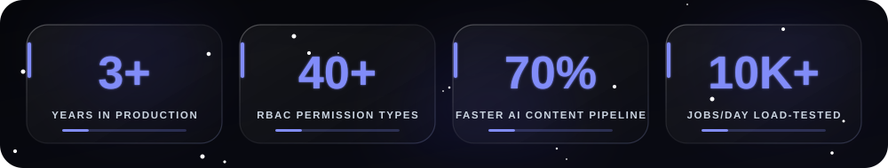
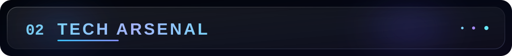
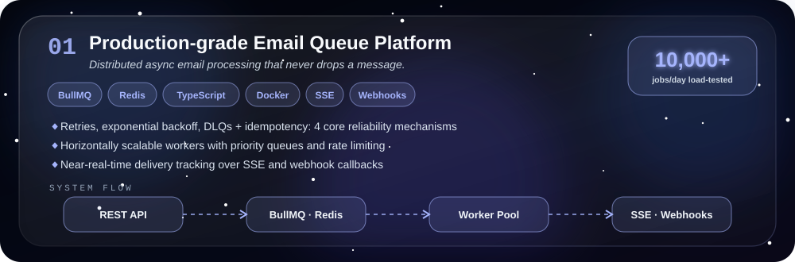
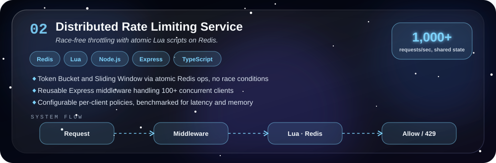
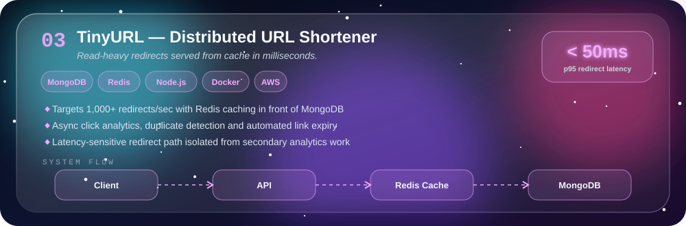
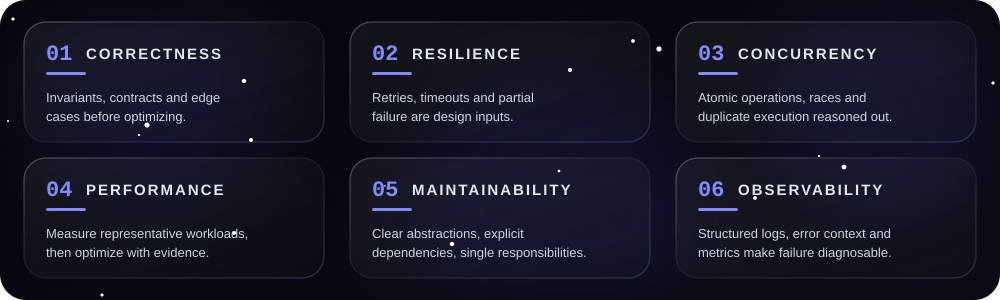
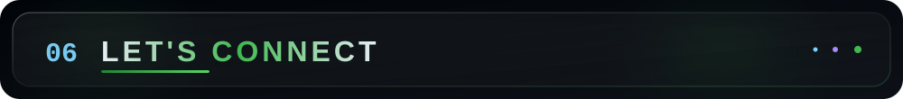

 

  

 

 

I'm **Sanjay Kollimarla**, a Software Engineer with **3+ years** of experience building scalable backend systems with **Node.js, TypeScript and JavaScript**. I design multi-tenant SaaS backends, asynchronous processing pipelines and real-time services, and I own features from architecture through deployment, production support and performance tuning.

I'm drawn to what happens *beyond* a successful API response: how concurrent operations stay correct, how queues recover from failure, how caching affects consistency, and how a system behaves under load.

<table>
<tr>
<td width="50%" valign="top">

#### ◈ SYSTEMS THINKING
- Multi-tenant architecture & tenant isolation
- Asynchronous, event-driven pipelines
- Concurrency, idempotency & consistency
- Fault isolation and failure recovery
- API contracts, RBAC & authorization

</td>
<td width="50%" valign="top">

#### ◈ PERFORMANCE THINKING
- MongoDB indexing, aggregation & schema design
- Redis caching strategies
- Throughput and latency analysis (p95)
- Load testing & reproducible benchmarks
- Resource-efficient background processing

</td>
</tr>
</table>

 

### Building reliable systems starts with understanding the hard problems.

Open to conversations about **backend engineering, distributed systems and system design**.

